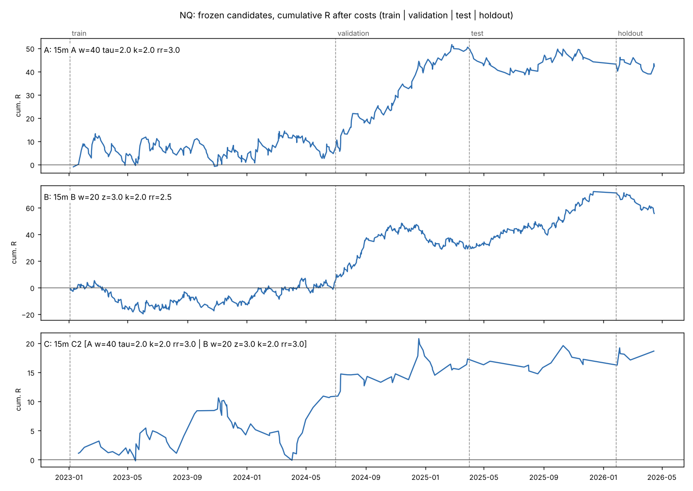
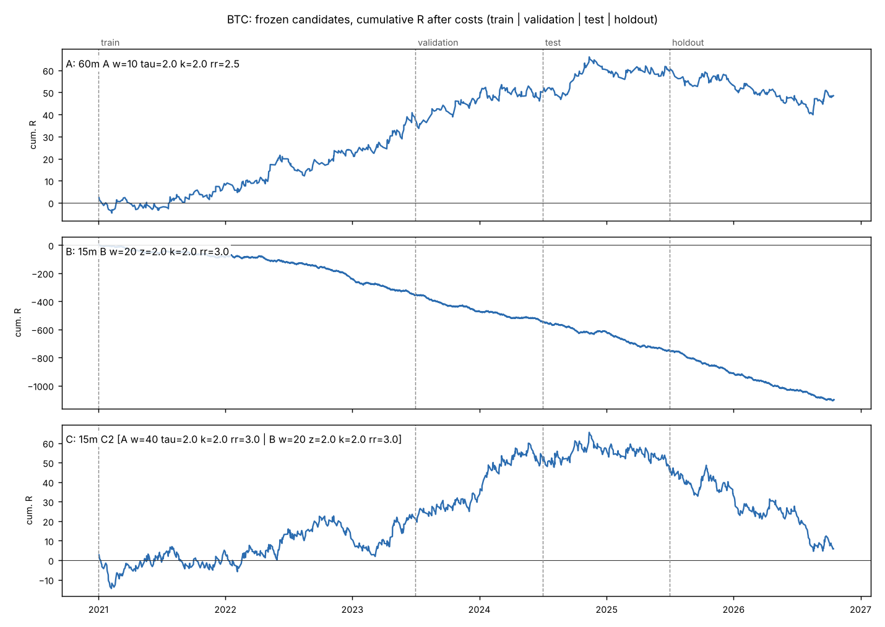

# Intraday NQ / MNQ Strategy Research — Report

**Primary market:** CME Nasdaq-100 futures (NQ data, traded as MNQ) · **Secondary:** BTC/USD (Bitstamp; costs of a BTC/USDT perpetual) · **Timeframes:** 1, 5, 15, 60 min · **Account:** $5,000, 0.5% risk (max 1%) · **Report date:** 2026-10-18

---

## 0. Read this first

**No strategy passed validation. The system's output is `NO TRADE`.**

The protocol was fixed and committed before selection ([PREREGISTRATION.md](PREREGISTRATION.md), commit `18430e5`).
The frozen configuration was committed before any unseen bar was loaded (`6901831`).
The one-shot evaluation followed (`7d0e1fc`). Results:

| Candidate (all 15-minute) | Train 2023-01→2024-06 | Validation 2024-07→2025-03 | **Test** 2025-04→2025-12 | **Holdout** (other vendor) 2026-01→04 |
|---|---|---|---|---|
| A — trend (z_mom 40, τ 2.0, stop 2·ATR, 1:3) | +0.02 R (232 tr) | +0.54 R (85) | **−0.10 R** (63) | **−0.08 R** (24) |
| B — mean reversion (z_bb 20, z 3.0, 2·ATR, 1:2.5) | +0.01 R (363) | +0.15 R (182) | **+0.27 R** (149) | **−0.34 R** (48) |
| C — regime-adaptive (session router: RTH→A, ETH→none) | +0.15 R (70) | +0.21 R (31) | **−0.00 R** (14) | **+0.24 R** (6) |

R = profit per trade in units of the initial risk, **after** commission and slippage.

Why each candidate was rejected:

* **A** looked excellent on validation (+0.54 R, 95% CI [+0.16, +0.94], and it beat 300 random-timing replications, p < 0.003).
  * It failed the walk-forward gate: re-running the selection quarter by quarter picked different parameters almost every quarter, and those picks lost out of sample.
  * In training its longs made +0.21 R and its shorts lost −0.21 R. The training "edge" was bull-market drift.
  * It then lost on both unseen periods.
* **B** failed the random-entry null in development (p = 0.057).
  * It then made +0.27 R on test (p = 0.006) and lost −0.34 R on the holdout (CI entirely below zero).
  * A strategy that swings between those two outcomes has no measured edge, only exposure to whatever the period rewards.
* **C** never had enough trades to say anything: 14 trades on test, 6 on the holdout.

**And at $5,000 / 0.5% risk, no MNQ trade could have been placed anyway.**
* A 15-minute stop of 2×ATR is about 60 points, so one MNQ contract risks about $120 against a $25 budget.
* Every 15-minute signal in test and holdout is rejected by the sizing rule (section 8).
* Only a CFD with 0.1-lot granularity could express these strategies at this account size, at about 1.6× MNQ's cost per R.

The secondary market gives the same answer (section 14).

* On BTC (perp taker costs), mean reversion lost in every one of 432 configurations.
* The best trend rule decayed from +0.12 R in training to +0.08 R on test (not significant) and −0.06 R over a 15-month holdout.

This is a negative result, and it is the correct output of a system built not to fabricate an edge.
Everything below documents how it was reached, so that it can be checked, reproduced, and extended with better data or new hypotheses.

---

## 1. Mathematical description of the candidate strategies

Notation, per timeframe bar *t*:

* P\*ₜ is the **gap-removed** close. Every between-day gap is subtracted cumulatively, so contract rolls, weekend gaps and the daily halt never enter a feature (section 3 explains why this matters for this data).
* dₜ = P\*ₜ − P\*ₜ₋₁.
* sₜ is the training-period time-of-day volatility factor (mean |d| per slot, normalised).
* σₜ is the volatility assumed for bar *t* using information up to *t*−1. It is a seasonally adjusted EWMA:

```
ℓₜ = λ ℓₜ₋₁ + (1−λ) (dₜ / sₜ)²,  λ = 0.97        σₜ = √ℓₜ₋₁ · sₜ
```

All entries are formed at a bar's close and filled at the next 1-minute bar's open.
Stops are k·ATR14 of the signal timeframe (Wilder, on P\*). Targets are RR·stop.
Every position is closed before the session ends (16:50 ET for NQ, 23:50 UTC for BTC).

### Strategy A — statistical trend-following

```
z_mom(W)ₜ = Σᵢ₌ₜ₋W₊₁..ₜ dᵢ  /  √( Σᵢ σᵢ² )
```

Under the null of a driftless martingale with conditional volatility σ, z_mom ≈ N(0,1).
This was verified in `tests/test_nqlab_features.py`: unit variance on a random walk, ±0.03.
A threshold of 2.0 therefore means the same thing at every timeframe and window.

* **Long** on a fresh crossing z_mom ≥ +τ (previous bar < τ). **Short** on z_mom ≤ −τ.
* Holding cap: 2W bars.
* **Hypothesis:** drift detectable over W bars persists over the next W bars by more than the round-trip cost.

### Strategy B — statistical mean reversion

```
z_bb(W)ₜ = (P*ₜ − SMA_W(P*)ₜ) / SD_W(P*)ₜ
```

* **Long** (fade) on a fresh crossing below −z. **Short** on a crossing above +z.
* Holding cap: W bars.
* **Hypothesis:** large deviations from the rolling mean are partly transient and revert by more than the cost.

### Strategy C — regime-adaptive

C routes A's signals through bars classified *trend*, routes B's through bars classified *range*, and trades nothing otherwise. Two variants were built at every timeframe from that timeframe's best A and B:

* **C1 (textbook).** The regime is the rolling variance ratio VR(4) over about two trading days.
  * VR ≥ 70th percentile (train) → trend. VR ≤ 30th → range.
  * Entries are blocked during CUSUM-detected volatility transitions and in the top-5% volatility state.
* **C2 (evidence-based).** Session is the only regime variable whose effect held in both train and validation (section 2).
  * RTH and ETH are each routed to A, B or nothing, according to which had positive and higher **training** expectancy there.
  * The routing decisions use train data only. The *idea* of routing by session came from looking at validation-period diagnostics, which is disclosed in the pre-registration and counted as a trial.

* **Hypothesis:** the classifier knows *ahead of time* which of A or B the next bars will reward.

### Parameter grids (fixed before selection)

| | W | threshold | stop k (×ATR) | RR | configs × 4 TFs |
|---|---|---|---|---|---|
| A | 10, 20, 40 | τ 1.5, 2.0, 2.5 | 1.0, 1.5, 2.0 | 1.5, 2.0, 2.5, 3.0 | 108 × 4 = 432 |
| B | 20, 40, 80 | z 2.0, 2.5, 3.0 | 1.0, 1.5, 2.0 | 1.5, 2.0, 2.5, 3.0 | 108 × 4 = 432 |
| C | — | — | — | — | 2 × 4 = 8 |

With the 32 entry-method runs (section 5.3), **904 configurations were evaluated**. That number enters the deflated Sharpe ratio.

---

## 2. Hypotheses tested, and what the data said

All on the development data only. Train is 2023-01-03 → 2024-06-30; validation is 2024-07-01 → 2025-03-31.
Source: `results/02_hypotheses_NQ.md`, `results/03_models_NQ.md`.

| # | Hypothesis | Test | Result | Holds in both periods? |
|---|---|---|---|---|
| H1 | Bar changes are serially dependent | Lo–MacKinlay VR(q), heteroskedasticity-robust z\* | All timeframes VR within 0.96–1.06. 1m VR(4) 0.992 / 0.996 (z\* −1.2 / −0.4). 60m 1.038 / 1.030 (z\* 1.2 / 0.6). 5m reverting only in validation (z\* −2.4) | **No** |
| H1s | …by session | VR(4), RTH vs ETH | ETH reverting at 1m (0.974 / 0.970, z\* −1.9 / −2.3) and 5m (0.971 / 0.957). RTH ≥ 1 at 15m/60m (60m: 1.077 / 1.043) | **Direction yes, significance weak** |
| H2 | Volatility clusters | Ljung–Box on d², ARCH-LM | p ≈ 0 at every timeframe in both periods | **Yes, overwhelmingly** |
| H3 | Price level is non-stationary; changes and z-deviations are stationary | ADF + KPSS | Level: ADF p 0.68–0.84, KPSS p 0.01 (unit root). Changes and z_bb: ADF p ≈ 0, KPSS p ≥ 0.10 | **Yes** (what makes z-statistics well defined) |
| H4 | Trend continues after z_mom crosses 2 | Forward move in σ√h units, day-clustered t | 1m (w20, h20): −0.014 (t −0.6) / +0.063 (t 2.0). 15m (w40, h10): −0.041 (t −0.6) / +0.365 (t 3.3). Signs flip between periods | **No** |
| H5 | Price reverts after z_bb crosses 2 | Same | 1m (w20, h5): +0.032 (t 3.8) / +0.018 (t 1.7). Consistent, but 0.03σ√5 ≈ 0.3 pts vs a 1.1-pt MNQ round trip. None at 15m/60m | **Yes, but uneconomic** |
| H6 | Intraday momentum (first 30 min + overnight → last 30 min; Gao et al. 2018) | Daily OLS, HAC t | β = −0.067 (t −2.0, 370 days) / +0.077 (t +1.7, 183 days) | **No — sign flips** |
| M1 | Better volatility forecasts exist than ATR | Next-bar QLIKE, out of sample | Seasonal EWMA / GARCH(1,1) beat ATR by 4% (1m), 9–10% (5m), 17% (15m), 26% (60m). Plain EWMA without seasonality is *worse* than ATR | **Yes** |
| M2 | Better vol forecasts give better stops | Same strategies, ATR stop vs seasonal-forecast stop at equal median width | No improvement in any cell (e.g. 15m A +0.083 → −0.090 R) | **No** |
| M3 | A regime classifier predicts the next bars' character | Realised forward variance ratio after each label | VR-rule TREND is followed by *more* reversion than RANGE at 5m–60m (anti-predictive). HMM states last 1.4–2.9 bars and predict volatility (15m next-bar vol / forecast: calm 0.73 → turbulent 0.93 in train, 0.69 → 0.98 in validation), not direction. Session: ETH reverts (1m t −11.7 / −6.3), RTH ≈ 0 | **Only session**, and mostly via bid-ask bounce |
| M4 | P(target before stop) is predictable | Logistic, gradient boosting, Bayesian beta-binomial; Brier skill, AUC, ECE | Brier skill −0.063…+0.044, AUC 0.47–0.67 (mostly 0.50–0.57). Filtering does not reliably raise expectancy | **No** |
| M5 | Order-flow imbalance predicts the next minute | Tick-rule OFI estimate on 1-second bars (5 weeks, 2026) | Same-minute correlation 0.62 (RTH), so the estimate carries information. Out-of-sample R² −0.004, sign hit 51% | **No** (exploratory, short sample) |

**Interpretation.** NQ is close to efficient at these horizons.

* The most significant structure in the data, overnight 1-minute mean reversion, is mostly bid-ask bounce in a thin book. Trading against it means paying the very spread that creates it.
* Volatility *is* forecastable, robustly, as in every market ever studied. Direction is not.
* That is the backdrop against which the strategies were built, and it predicted the outcome.

Ljung–Box assumes constant variance and over-rejects under volatility clustering. Its tiny p-values on raw changes (|ρ₁| ≤ 0.03) should be read with the robust z\*, not as evidence of predictability.

---

## 3. Data requirements and source limitations

### What was available

No market-data API is reachable from this environment (Binance, Yahoo, CME, Polygon, Dukascopy and others are refused by the network policy). Three public datasets on GitHub were reachable, downloaded with `python3 -m nqlab.fetch`, and pinned to git blob hashes:

| Name | Content | Span | Use |
|---|---|---|---|
| **NQ-A** | CME NQ 1-minute OHLCV, continuous, back-adjusted (repo `MoebiusSC/nq-es-trader-validated`; vendor unstated, NinjaTrader-style) | 2022-12-26 → 2025-12-11, 766 trading days | train / validation / test |
| **NQ-B** | CME NQ and MNQ 1-minute and 1-second OHLCV from the TopstepX API (repo `axb0306/cme-futures-ohlc`), front month, unadjusted | 1m: 2026-01-20 → 2026-04-15; 1h: from 2025-03-21 | independent holdout; cross-check |
| **BTC** | Bitstamp BTC/USD 1-minute OHLCV (repo `ff137/bitstamp-btcusd-minute-data`, CC BY-SA 4.0) | 2019-01-01 → 2026-10-18 | secondary market |

### What the validation found (`results/01_data.md`) — and handled explicitly

* **NQ-A has exactly 1,048,575 rows, Excel's row limit.** The file was truncated by a spreadsheet mid-session, so the final partial day (2025-12-12) is dropped.
* **NQ-A stamps bars with their close time** (first Globex bar 18:01, last 17:00). It is converted to open-time stamps. A one-minute stamp error would put every fill one bar early, which is the look-ahead most backtests never notice.
* **NQ-A is additively back-adjusted.** On the 4,286 overlapping hours of 2025:
  * NQ-A = NQ-B + 708.5 points (Mar–Jun), + 494.0 (Jun–Sep) and + 256.5 (Sep–Dec), stepping only at the rolls.
  * Hourly range correlation is 0.998 and the volume ratio is 1.000. Same CME feed, different contract handling.
  * Consequences:
    * Point differences are exact; price levels and percentage returns are not (early-2023 levels are about 2,700 points too high).
    * Every feature is built from point differences of the gap-removed price, and P&L is in points × $2 for MNQ, which is exact.
* **NQ-B is UTC and front-month.** Converted to ET. Its roll and weekend jumps are removed by the same gap-removal step.
* **Integrity:** 0 duplicates, 0 non-monotonic stamps, 0 prices off the 0.25 tick grid, 0 OHLC violations, 0 intraday gaps over 5 minutes.
  * Short days are all genuine early closes: 2023-04-07 Good Friday, 2025-01-09 national day of mourning, 2025-11-28 day after Thanksgiving.
* **BTC:** no missing minutes, but 2.17% are zero-volume filler bars inserted by the vendor (flat O=H=L=C). They are kept for exit checks and carry no information.

### What is NOT available, and therefore NOT claimed

| Requested input | Status |
|---|---|
| Bid-ask spread | **Not observed.** Costs are assumptions: 1 tick of slippage per side in RTH, 2 ticks in ETH, plus commission. Their sensitivity is tested (section 9). |
| Order-book depth / imbalance | **Not available in any reachable source.** Not tested. Displayed size would not have been treated as support or resistance anyway. |
| Trade-by-trade aggressor side / true volume delta | **Not available.** A tick-rule *estimate* from 1-second bars (5 weeks) is the only order-flow proxy, and it is labelled as an estimate (M5). |
| CFD prices | **Not available.** CFD results are a **cost model** applied to the NQ price path (US100: $1/pt, 0.1-lot minimum, 1.5-pt RTH / 3-pt ETH spread, no commission). A real broker's quote differs from futures by the basis and by its own spread policy. |
| BTC/USDT perpetual prices | **Not available.** Bitstamp spot BTC/USD is the price path; costs model a USDT-M perpetual taker (5 bps fee + 1 bp slippage per side). Funding is ignored (positions are intraday). |
| A second NQ history before 2023 | **Not available.** The development sample is 2.2 years, a single bull-market regime with episodic shocks. |

### Futures versus CFDs

| | NQ / MNQ futures (CME) | US100 / NAS100 CFD (broker) |
|---|---|---|
| Price | Exchange-traded, central order book | Broker-quoted, derived from the cash index or futures |
| Hours | Sun–Fri 18:00–17:00 ET, 1-hour daily halt | Broker-specific, usually similar, with breaks |
| Costs | Commission (~$0.62/side MNQ, ~$2.10 NQ) + 1-tick spread | No commission; spread 1–2 pts RTH, wider overnight; overnight financing |
| Size granularity | 1 MNQ = $2/pt (minimum risk ≈ $2 × stop) | Often 0.1 lot × $1/pt = $0.10/pt |
| Rolls | Quarterly (this project removes the roll gap from features) | None (financing instead) |
| Counterparty | Clearing house | The broker |

---

## 4. Python implementation

`nqlab/` (about 2,800 lines) with `experiments/` and `tests/`. Layout and quick start are in [README.md](README.md). Design choices that carry the results:

* **`engine.py` — execution, numba-compiled.** Exits are resolved on **1-minute bars for every timeframe**, so a 1-hour signal's stop and target are checked minute by minute. Seventeen rules are tested in `tests/test_nqlab_engine.py`:
  * fill at the next bar's open, never the signal close;
  * adverse slippage on entry and stop;
  * the **stop is booked when one minute touches both** stop and target;
  * a bar opening through the stop fills at the open, so a gap costs more than 1R;
  * targets need a 1-tick **trade-through**;
  * time exits;
  * flatten before the session end, and no entry in the last 10 minutes or across days;
  * overlapping signals are dropped and counted;
  * whole-contract sizing that **rejects** rather than rounds up;
  * a clean stop-out costs exactly −1R including costs;
  * daily loss limit and consecutive-loss pause;
  * random entries on a random walk earn ~0 R before costs and reliably negative after.
* **`features.py` — causal by construction and by test.** Features computed on data truncated at bar *t* must equal full-history features at *t* (tested at 1m, 5m and 60m). This test caught two real look-aheads during development (a volatility seed and a time-of-day lookup) before any strategy ran.
* **`regime.py`.** HMM parameters come from hmmlearn. State probabilities come from a **custom forward filter**, because hmmlearn's `predict`/`predict_proba` use the forward-backward pass or Viterbi, which read the future.
* **`selection.py`, `validation.py`.** Day-clustered scores, the plateau test, walk-forward, day-block bootstrap, Monte Carlo, deflated Sharpe.
* **`live.py`.** Signal output in the required format (section 10).
* **Reproducibility.** Data pinned by hash. Splits, grids, costs and gates live in `config.py`, `strategies.py` and the pre-registration. All randomness is seeded. Each experiment writes `.json` and `.md` to `results/`. The test suite has 46 tests: 25 for nqlab plus the repository's 21 pre-existing ones.

---

## 5. Backtesting methodology

### 5.1 Protocol

```
2023-01-03 ─── train ─── 2024-06-30 ─── validation ─── 2025-03-31 ─── test ─── 2025-12-11   (NQ-A)
                       walk-forward: 12-month in-sample → next quarter, 2024Q1…2025Q1
                                                                    2026-01-27 ─ holdout ─ 2026-04-15   (NQ-B, other vendor)
```

1. **Development** (train + validation only). The development lab is built with data cut off at 2025-03-31, so test and holdout bars are not even loaded.
2. **Selection** by a pre-registered rule (below), producing a frozen configuration that is committed to git.
3. **One-shot evaluation** on test and holdout. The script refuses to run unless the frozen file is committed and unmodified.

**Edge** is measured in R with exact fractional sizing and no risk governor. That answers "does a statistical edge exist?" independently of account size. **Account results** use whole contracts, compounding and the risk governor, and are reported separately (section 8). They are never used to select.

### 5.2 Selection rule and gates (pre-registered)

* **Score** = validation mean R − 1.96 × day-clustered standard error, the lower edge of a 95% interval. This ranks by what can be relied on, not by the highest mean.
* **Eligible** if train mean > 0, validation mean > 0, at least 30 validation trades, and a **plateau**: at least 60% of one-step grid neighbours are also positive on validation.
* **Development gates** (all required):
  * D1 validation > 0;
  * D2 train > 0;
  * D3 plateau;
  * D4 walk-forward out-of-sample mean > 0;
  * D5 beats ≥ 95% of 300 random-timing replications with identical exits (only *timing* is randomised; the side mix, stops and targets are kept).
* **Unseen-data gates:**
  * T1 test: mean > 0, PF > 1 and bootstrap p(mean ≤ 0) < 0.10;
  * H1 holdout: mean > 0.
* **Verdict** VALIDATED only if all of the above hold; otherwise NO TRADE.

### 5.3 Entry methods compared in isolation (Module 4)

Same exits for all (1.5·ATR stop, 2R target, 20-bar cap). R per trade after costs, train / validation (t-stat):

| Entry trigger | 1m | 5m | 15m | 60m |
|---|---|---|---|---|
| Deviation fade, z-score | −0.23 / −0.16 | −0.11 / −0.06 | −0.05 / −0.03 | −0.04 / −0.07 |
| Deviation fade, causal Nadaraya–Watson | −0.23 / −0.16 | −0.13 / −0.09 | −0.08 / −0.03 | −0.08 / −0.06 |
| Deviation fade, session VWAP | −0.23 / −0.15 | −0.09 / −0.09 | −0.10 / −0.04 | −0.03 / −0.05 |
| Regression trend change, OLS slope z | −0.19 / −0.09 | +0.00 / −0.09 | −0.02 / +0.02 | +0.10 / −0.20 |
| Regression trend change, Kalman slope z | −0.23 / −0.14 | −0.08 / −0.07 | +0.01 / −0.07 | +0.02 / −0.00 |
| Momentum shift, z_mom | −0.21 / −0.12 | −0.05 / +0.00 | +0.10 / +0.01 | −0.01 / +0.23 |
| Volatility expansion (range shock) | −0.25 / −0.13 | −0.11 / −0.04 | −0.06 / +0.03 | −0.03 / +0.05 |
| Breakout + z_mom > 1 | −0.23 / −0.14 | −0.06 / +0.01 | −0.04 / +0.02 | −0.01 / +0.27 (t 2.4) |
| Order-flow imbalance | not available | | | |

No trigger is positive in both periods at a meaningful t-stat.

* Every 1-minute trigger loses 0.09–0.25 R, with |t| between 3 and 32. Costs (≈ 0.13 R per round trip) exceed any edge.
* The Nadaraya–Watson line uses the one-sided (causal) kernel. The two-sided "NW envelope" common on charting sites **repaints**: its past values change as new bars arrive. It cannot be backtested honestly and was not used.

### 5.4 Cost model (MNQ)

* Entry: next 1-minute open plus 1 tick (RTH) or 2 ticks (ETH).
* Stop: stop price minus 1–2 ticks, or the open if gapped through.
* Target: limit at the target price, filled only if traded through by 1 tick.
* Commission: $0.62 per side.
* Round trip ≈ 1.12 MNQ points, which is **0.13 R on a typical 1-minute stop and 0.02–0.03 R at 15 minutes** (`results/01_data.md`).

---

## 6. Performance comparison (identical periods, assumptions and metrics)

R-space: exact sizing at $25 per R, risk governor off. Sharpe, Sortino and Calmar are annualised from daily P&L over every trading day, including days with no trade.

| Candidate | Period | Trades | Exp. R | 95% CI | Win % | PF | Total R | Sharpe | Max DD % |
|---|---|---|---|---|---|---|---|---|---|
| A | train | 232 | +0.020 | [−0.17, +0.22] | 33.2 | 1.03 | +4.7 | 0.17 | 6.6 |
| A | validation | 85 | +0.539 | [+0.16, +0.94] | 47.1 | 2.13 | +45.8 | 3.12 | 2.1 |
| A | **test** | 63 | **−0.100** | [−0.44, +0.29] | 28.6 | 0.86 | −6.3 | −0.62 | 6.0 |
| A | **holdout** | 24 | **−0.076** | [−0.66, +0.54] | 25.0 | 0.88 | −1.8 | −0.51 | 3.6 |
| B | train | 363 | +0.010 | [−0.13, +0.16] | 35.8 | 1.02 | +3.5 | 0.11 | 12.2 |
| B | validation | 182 | +0.153 | [−0.05, +0.36] | 40.7 | 1.27 | +27.9 | 1.67 | 8.0 |
| B | **test** | 149 | **+0.272** | [+0.06, +0.49] | 47.0 | 1.55 | +40.5 | 2.85 | 4.6 |
| B | **holdout** | 48 | **−0.342** | [−0.60, −0.03] | 29.2 | 0.47 | −16.4 | −4.39 | 8.2 |
| C | train | 70 | +0.154 | [−0.12, +0.44] | 50.0 | 1.36 | +10.8 | 0.87 | 5.1 |
| C | validation | 31 | +0.209 | [−0.23, +0.70] | 48.4 | 1.51 | +6.5 | 1.01 | 3.0 |
| C | **test** | 14 | **−0.004** | [−0.52, +0.61] | 42.9 | 0.99 | −0.1 | −0.02 | 1.6 |
| C | **holdout** | 6 | **+0.235** | [−0.85, +1.56] | 33.3 | 1.46 | +1.4 | 0.78 | 1.0 |



The full per-period metrics are in `results/05_final_NQ.md`: average win and loss, Sortino, Calmar, holding time, consecutive wins and losses, gross versus net, long/short, by session and by volatility regime. Highlights from the unseen periods:

| | A test | A holdout | B test | B holdout |
|---|---|---|---|---|
| Avg win / avg loss (R) | +2.08 / −0.97 | +2.23 / −0.84 | +1.63 / −0.94 | +1.03 / −0.91 |
| Gross R → net R (cost) | −0.078 → −0.100 (0.022) | −0.058 → −0.076 (0.017) | +0.295 → +0.272 (0.023) | −0.325 → −0.342 (0.017) |
| Sortino / Calmar | −1.07 / −0.73 | −1.02 / −1.12 | 5.72 / 6.29 | −5.14 / −3.84 |
| Avg holding (min) | 270 | 335 | 144 | 120 |
| Max consecutive W / L | 3 / 8 | 2 / 5 | 5 / 8 | 3 / 7 |
| Long vs short (R) | −0.16 / −0.05 | −0.16 / −0.01 | +0.33 / +0.19 | −0.56 / −0.16 |

**By session.** B's test profit came almost entirely from London (51 trades, +0.63 R). It lost at the RTH open in test (−0.19 R) and in the holdout (−0.97 R, 0 wins in 14).

**By regime.** Neither candidate's results line up with the volatility regime consistently across test and holdout. For example, A is +0.47 R in high volatility on test but −0.43 R on the holdout.

### What each metric can and cannot tell you

* **Net profit / return.** Depend on the sizing scale and the period. Not comparable across periods of different length or volatility.
* **Win rate.** Meaningless without the payoff. A 25% win rate at 1:3 breaks even. Never read alone.
* **Average win / loss.** Payoff shape. The loss side is anchored at about −1 R by construction; gaps push past it.
* **Profit factor.** Gross wins / gross losses. Unstable with few trades, since one trade can move it by 0.5.
* **Expectancy (R per trade).** The quantity that matters. Report it with its confidence interval; with 60 trades the interval is about ±0.35 R wide.
* **Maximum drawdown.** A single path's worst case. Heavily dependent on sequence; the Monte Carlo distribution is more informative.
* **Sharpe / Sortino.**
  * Daily, √252-annualised, over all days.
  * They assume roughly i.i.d. daily returns. Sortino is undefined-ish with few losing days.
  * 180 days of data puts the standard error of an annualised Sharpe near ±1.2.
* **Calmar.** CAGR / max DD. Doubly noisy (two noisy estimates in a ratio); short samples inflate it.
* **Trade count, holding period.** Determine statistical power and cost drag.
* **Long/short, session, regime splits.** Each subgroup has a fraction of the trades; most splits here are not individually significant, and differences between them are mostly noise.
* **Consecutive losses.** Path-dependent. The Monte Carlo streak distribution is the better guide.
* **Results after costs.** All numbers here are after costs; gross is shown for contrast.
* **Out-of-sample performance.** The only number that speaks to the future, and only weakly: 63–149 trades over 8 months is one regime's sample.
* **Monte Carlo drawdown.** Resamples the observed days. It cannot produce a regime that is not in the sample, and inherits the sample's luck (see B, section 8).

**Statistical reliability.**

* The only significant positive results are A on validation and B on test, each in one period, each reversed in the next.
* A's deflated Sharpe (904 trials) is 0.00 against the empirical cross-trial variance and 0.29 against a pure-noise benchmark (hurdle 3.7 annualised). Both are far below the 0.95 bar.
* None of the reported positive figures is statistically reliable as evidence of a persistent edge.

---

## 7. Out-of-sample validation

Three layers, each harder to pass than the last:

1. **Validation (2024-07 → 2025-03).** Forty-six A configurations at 60m and 26 at 15m were eligible. 58% of all 60m A configurations were positive in both train and validation, so trend at 60m looked like a broad plateau, not a fluke.
2. **Walk-forward** (selection re-run each quarter from the trailing 12 months):

| Family | Quarterly choices | OOS trades | OOS mean R | 95% CI | p(≤0) |
|---|---|---|---|---|---|
| A | 60m w20 → 60m w10 → 15m w20 → 60m w10 → 15m w40 | 166 | −0.036 | [−0.23, +0.17] | 0.64 |
| B | 15m w20 z2.5 ×2 → 15m w20 z3.0 ×3 | 493 | +0.038 | [−0.07, +0.15] | 0.25 |
| A or B (adaptive) | mostly A | 208 | −0.069 | [−0.25, +0.12] | 0.76 |

   The A family's best configuration changes almost every quarter, and the in-sample winner then loses. This is the signature of a parameter set fitted to the period's character rather than a persistent effect. B's selection procedure was stable, but its edge was not distinguishable from zero.
3. **Test and an independent holdout** (section 6): A lost on both. B won on test and lost on the holdout.

**Conclusion.** Nothing survives genuinely unseen data. Validation-period strength was period-specific.

---

## 8. Risk-management analysis

### The account cannot size these trades

| Timeframe | Median ATR (pts, RTH, train) | One MNQ at 1×ATR stop | Share sizable at 0.5% ($25) | at 1% ($50) | Cost per round trip (R) |
|---|---|---|---|---|---|
| 1m | 8.6 | $19 | 77% | 99% | 0.126 |
| 5m | 19.5 | $41 | 4.8% | 76% | 0.057 |
| 15m | 29.9 | $62 | 1.0% | 21% | 0.037 |
| 60m | 45.2 | $92 | 0% | 1.5% | 0.025 |

With a 2×ATR stop (the frozen candidates' setting), one MNQ contract at 15m risks ~$120. One NQ is never sizable at $5,000.

**Smaller stops are cheap to size but expensive to trade; larger stops are cheap to trade but impossible to size.** At $5,000, MNQ forces the trader into the 1-minute regime where costs are highest (0.13 R per trade), and section 5.3 shows every 1-minute trigger losing.

Account simulation on unseen data ($5,000, whole contracts, compounding, governor on: −2% daily stop, pause after 4 consecutive losses):

| Candidate | Period | MNQ 0.5% | MNQ 1% | US100 CFD 0.5% |
|---|---|---|---|---|
| A | test | 0 of 104 signals fillable | 2 filled, +$62 | 62 filled, −$202 (−4.0%) |
| A | holdout | 0 of 43 | 0 of 43 | 24 filled, −$66 (−1.3%) |
| B | test | 0 of 151 | 4 filled, −$24 | 146 filled, **+$900 (+18.0%)** |
| B | holdout | 0 of 49 | 0 of 49 | 47 filled, **−$343 (−6.9%)** |
| C | test / holdout | 0 / 0 | 0 / 0 | −$41 / +$36 |

Position sizing never exceeded the budget: oversize signals were rejected (counted), never rounded up. No martingale, averaging down, or pyramiding exists in the code. The governor never triggered on these low-frequency candidates.

### Monte Carlo (5,000 one-year paths, whole days resampled from test + holdout, 0.5% risk per R)

| | A | B | C |
|---|---|---|---|
| Median / 95th / 99th pct max drawdown | 19.5% / 32.0% / 37.2% | 7.7% / 14.0% / 17.7% | 7.7% / 14.6% / 18.4% |
| P(drawdown > 10%) / > 20% | 94% / 48% | 24% / 0.3% | 25% / 0.4% |
| Median 1-year return | −12.9% | +21.2% | +8.8% |
| P(losing year) | 86% | 5% | 21% |
| Median / 95th pct losing streak | 14 / 22 | 9 / 14 | 9 / 14 |

Read B's column as a **warning about Monte Carlo, not a forecast**. Resampling a favourable sample (test was strongly positive) produces a favourable distribution, yet the next independent period lost 0.34 R per trade. Monte Carlo quantifies path risk *given* an edge; it cannot establish the edge.

Even for a strategy with zero true edge, a 0.5% risk per trade and 1:3 payoffs implies median losing streaks of 9–14 trades and drawdowns of 8–20% per year. That is the cost of the payoff shape, independent of skill.

---

## 9. Parameter sensitivity analysis

**Neighbouring parameters (plateau).**
* A's finalist: 80% of its grid neighbours were positive on validation. B's: 100%. Both passed the plateau gate.
* So the validation results were not knife-edge; the *period* was the problem, not the parameter.

**Costs** (finalist A, validation R/trade):

| As modelled | Zero slippage | Slippage ×2 | Commission ×2 | Target trade-through 0 / 2 ticks | Frictionless |
|---|---|---|---|---|---|
| +0.539 | +0.549 | +0.528 | +0.521 | +0.539 / +0.539 | +0.568 |

At 15 minutes, costs are ~0.03 R per trade; the results are not a cost artefact.
At 1 minute they are decisive: the median *gross* expectancy (net + costs, validation) is +0.012 R for A and −0.028 R for B, against costs of 0.13–0.15 R. Not one of the 216 one-minute configurations is positive in either period.

**Exits (Module 5)**, finalist A, validation:

| Exit | Train R | Validation R |
|---|---|---|
| Fixed 1:3 (selected) | +0.020 | +0.539 |
| Time exit only (no target) | +0.066 | +0.664 |
| Stop from the seasonal vol forecast | +0.052 | +0.263 |

For B, a target at the rolling mean (+0.035 / +0.021) did worse than fixed RR (+0.010 / +0.153). The risk-to-reward grid of 1:1.5, 1:2, 1:2.5 and 1:3 is part of every grid row in `results/04_grid_NQ.csv` (regenerated by e04). Larger RR was preferred at 15m and 60m for A, consistent with a right-tailed trend payoff in trending periods.

**Components (ablation, finalist A).** Each component had to improve both train and validation to earn a place:

| Component | Train R | Validation R | Kept? |
|---|---|---|---|
| none | +0.020 | +0.539 | — |
| RTH only | +0.155 | +0.209 | no |
| block CUSUM transitions | +0.038 | +0.495 | no |
| block extreme volatility | +0.030 | +0.384 | no |
| probability filter (logistic) | +0.392 | +0.318 | no |

No component improved both. For B, the volatility block and the probability filter did improve both, but B itself failed the development gates. The regime and machine-learning layers therefore add no measured out-of-sample value and are excluded, as the brief requires.

---

## 10. Final strategy selection

**Selected: none. System output: NO TRADE.** Per the pre-registered rule, no finalist passed development:

| Gate | A | B | C |
|---|---|---|---|
| D1 validation > 0 | ✓ | ✓ | ✓ |
| D2 train > 0 | ✓ | ✓ | ✓ |
| D3 plateau | ✓ | ✓ | n/a |
| D4 walk-forward > 0 | ✗ | ✓ | ✗ |
| D5 beats random timing | ✓ | ✗ (p 0.057) | ✗ (p 0.29) |
| T1 test | ✗ | ✓ | ✗ |
| H1 holdout | ✗ | ✗ | ✓ (6 trades) |

No candidate passes all gates. Each row of ✓ fails somewhere else, which is the pattern of noise, not of an edge.

### Live output (`python3 -m nqlab.live --demo`)

```
INSTRUMENT: MNQ (CME Micro E-mini Nasdaq-100)
SIGNAL: NO TRADE
TIMEFRAME: 15 minutes (last closed bar 2026-04-15 19:15-19:30 America/New_York)
ENTRY PRICE: -
STOP-LOSS: -
TAKE-PROFIT: -
RISK-TO-REWARD: -
ESTIMATED WIN PROBABILITY: unavailable — no probability model passed out-of-sample calibration
EXPECTED VALUE: unavailable — no strategy has a validated positive expectancy after costs
POSITION SIZE: 0 contracts
MARKET REGIME: session=ETH; volatility=low (deseasonalised level vs 10-day median, train terciles); variance-ratio label=NEUTRAL (not predictive out of sample — informational)
SIGNAL CONFIDENCE: unavailable — not validated
REASON FOR SIGNAL: NO strategy passed the development gates -> system outputs NO TRADE; final verdict on unseen data: NOT VALIDATED
INVALIDATION CONDITION: -
```

Research view of a rejected candidate (`--candidate B --until "2026-04-15 09:59"`). The signal is shown, but it is explicitly not a trade:

```
SIGNAL: NO TRADE (candidate B would be SHORT — NOT VALIDATED, research view only)
ENTRY PRICE: ~26068.50 — market order at the next bar's open (last close 26068.50)
STOP-LOSS: 26138.75 (70.20 pts = 2.0 x ATR14)
TAKE-PROFIT: 25893.00 (175.49 pts)
RISK-TO-REWARD: 1:2.50
ESTIMATED WIN PROBABILITY: unavailable — no probability model passed out-of-sample calibration (...). Historical win FREQUENCY (P&L > 0) on unseen data: 42.6% over 197 trades — a frequency, not a calibrated forecast
EXPECTED VALUE: not validated. Unseen-data average +0.122 R/trade after costs (= $+3.06 at $25/R)
POSITION SIZE: 0 — one contract risks $142.13 > $25.00 budget (0.5% of $5,000); trade NOT allowed
```

### What would change the answer

* **A longer and more varied NQ history** (2008–2022 includes bear markets and range years) to test A across regimes. Its edge was regime-specific here.
* **Real bid/ask and order-book data** (e.g. CME MDP3 via a vendor) to test the microstructure hypotheses that this data cannot address.
* **A larger account or a CFD.** It does not create an edge, but it lets a validated 15m/60m edge be expressed. At $5,000 and 0.5% risk, MNQ can only trade 1-minute stops, which costs too much.
* **A new hypothesis.** It must be written down and committed *before* it is tested on the remaining data. The test and holdout used here are now spent: anything tuned after seeing them would be in-sample.

---

## 11. Running the project

```bash
pip install -r requirements.txt            # Python 3.11+; numba, statsmodels, arch, hmmlearn, scikit-learn
python3 -m nqlab.fetch                     # ~220 MB into data/raw, hash-verified (--verify to re-check)
python3 -m pytest tests -q                 # 46 tests, ~75 s
python3 experiments/e01_data.py            # ~25 s
python3 experiments/e02_hypotheses.py      # ~1 min   (add --market BTC to any of e02-e05)
python3 experiments/e03_models.py          # ~1.5 min (BTC ~2 min)
python3 experiments/e04_strategies.py      # ~1.5 min (BTC ~3 min); writes results/frozen_config_NQ.json
git add results/frozen_config_NQ.json && git commit -m "freeze"   # e05 refuses otherwise
python3 experiments/e05_final.py           # one-shot test + holdout
python3 -m nqlab.live --csv my_1m_bars.csv # live signal (CSV: timestamp,open,high,low,close,volume; ET)
```

**Where to change things:**
* costs, sessions, account and splits: `nqlab/config.py`;
* grids: `nqlab/strategies.py` (`A_GRID`, `B_GRID`);
* gates: `nqlab/selection.py` and `experiments/e04_strategies.py`.

Changing any of these after looking at test or holdout results makes those results in-sample. Re-freeze, and find new unseen data.

**Adding a strategy.** Write a function `(features, tf, params) -> Signals` (entry bar index, side, stop distance, target distance, holding cap). The engine, labelling, walk-forward, null test, bootstrap and Monte Carlo all work on it unchanged.

---

## 12. TradingView Pine Script (optional)

`pine/nq_frozen_candidates.pine` (Pine v5) is **generated** from the frozen configuration by `pine/generate_nq_pine.py`. It embeds:

* the training time-of-day volatility profile and regime thresholds;
* the gap-removed price, Wilder ATR on it, the seasonal EWMA, z_mom and z_bb;
* the frozen A/B/C rules;
* whole-contract sizing that refuses oversize trades;
* time and session exits;
* an info table showing the statistics, the regime, and "1 contract risk vs budget".

* **Default mode is `NO TRADE (validated system)`**: it places no orders. The three research modes exist for inspection and paper trading only.
* **Fidelity is checked, not assumed.** TradingView cannot run here, so `pine/verify_pine_math.py` mirrors the Pine logic bar by bar on TradingView-style bars (every minute of the Globex day) and compares the triggers with the Python engine on 2023–2025 data:
  * Every tradeable Python trigger is reproduced: A 478 of 478, B 527 of 527.
  * Getting there required one fix: the bar that straddles the 16:50 flatten must use its last pre-flatten minute. The script reads that via `request.security_lower_tf`.
  * The mirror emits one extra trigger per strategy, each on an exchange early-close day (2024-12-24, 2023-05-29). There the Python engine rejects the entry because the session ends; TradingView would fill it at the next session's open. The script guards entries with `session.islastbar`. Check that it fires on your chart's holiday sessions.
* **Remaining differences:**
  * TradingView resolves fills on chart bars. Enable Bar Magnifier for 1-minute resolution; without it, TradingView's intrabar path assumption is *not* the conservative stop-first rule used here.
  * Time and session exits fill at the next bar's open.
  * `ta.rma` seeds ATR differently during warm-up.
* The syntax passes the repository's continuation-indent checker (`pine/check_pine.py`). It has not been compiled in TradingView from this environment, so the first load may need minor fixes.

---

## 13. Paper trading before any live deployment

There is no validated strategy, so there is nothing to deploy. If a future strategy passes these gates, the path is:

1. **Pre-register the paper test.** Write down the frozen configuration, the minimum sample (at least 100 trades or 3 months, whichever is later), and the pass rule (e.g. mean R > 0 with the bootstrap lower bound above −0.1 R, and realised slippage ≤ assumed). Commit it before starting.
2. **Run the live signal generator on real-time bars** (`nqlab.live` on a 1-minute feed, or the Pine script on a TradingView paper account or a broker simulator such as the CME-connected demo of your FCM). Log every signal, including the ones you would not take.
3. **Record the execution truth.** Fill price versus the next-bar-open assumption, stop slippage in ticks, how often targets fill on a touch versus a trade-through, rejected orders, and data outages.
4. **Compare like with like.** Re-run `e05`'s metric code on the paper trades; compare R per trade and slippage to the backtest's assumptions. If realised costs exceed the model, re-run the backtest with realised costs before anything else.
5. **Sizing.**
   * At $5,000 on MNQ, size is 0 for any stop wider than ~11 points at 0.5% risk. Do not raise risk above 1% to force a trade; the rejection *is* the risk rule working.
   * If a CFD is used, test it on that broker's own data and spreads. CFD results here are a cost model, not that broker's prices.
6. **Kill switches before going live.** Daily loss limit (default −2%), pause after 4 consecutive losses, maximum one position, and a hard stop on the venue at all times.
7. **Go live only at minimum size,** and only after the paper test passes its pre-registered rule. Keep evaluating against the same rule; a strategy that stops meeting it is turned off, not re-tuned.

---

## 14. Secondary market — BTC

Same code, protocol and gates.

* **Price path:** Bitstamp BTC/USD 1-minute.
* **Costs:** a BTC/USDT USD-M perpetual at the base taker tier, 5 bps fee + 1 bp slippage per side (12 bps round trip). Fractional sizing in 0.001 BTC.
* **Session:** UTC day, flat by 23:50.
* **Splits:**
  * train 2021-01 → 2023-06;
  * validation 2023-07 → 2024-06;
  * test 2024-07 → 2025-06;
  * holdout 2025-07 → 2026-10 (15 months, the longest unseen window in the project).
* **Commits:**
  * frozen configuration `cd07344` before the one-shot run;
  * results in `results/0[2-5]_*_BTC.md`.

**Hypotheses** (train / validation):

* 1-minute changes mean-revert robustly: VR(4) 0.969 / 0.963, z\* −3.7 / −3.8. 5m reverts in train only (0.952, z\* −3.0). 15m and 60m are ≈ 1 in validation.
* Yet the z-score fade test *flips sign* at 1m (+0.016 R-units, t 2.9 → −0.012, t −1.2). The 1-minute reversion is consistent with quote bounce on a single venue, not with a tradeable effect.
* Volatility clusters (ARCH p ≈ 0). GARCH beats ATR by 6% at 60m and is ≈ equal at 5m/15m.
  * At 1m, ATR is degenerate: the vendor's zero-range filler minutes collapse it (QLIKE 18 vs ~1.5).
* Probability models: Brier skill ≤ 0.013 everywhere. Regime labels are again not predictive (variance-ratio TREND is followed by more reversion than RANGE).

**Development.**

* **Mean reversion (B): 0 of 432 configurations positive in either period.** Costs are 0.14–0.66 R per trade.
* **Trend (A):** 24% of 60m configurations positive in both periods.
* **Walk-forward:**
  * A: 342 out-of-sample trades, −0.015 R (CI −0.15 … +0.12).
  * B: stood aside in 6 of 10 quarters (nothing positive in-sample) and lost −0.23 R when it traded.
* Every finalist failed D4. **Verdict: NO TRADE.**

**Unseen data** (frozen finalists, R per trade after costs):

| Candidate | Train | Validation | **Test** 2024-07→2025-06 | **Holdout** 2025-07→2026-10 |
|---|---|---|---|---|
| A — trend, 60m (z_mom 10, τ 2.0, 2·ATR, 1:2.5) | +0.123 (305 tr, p 0.02) | +0.096 (129) | **+0.077** (123, CI −0.11…+0.27, p 0.22) | **−0.063** (176, CI −0.20…+0.08) |
| B — mean reversion, 15m (z_bb 20, z 2.0, 2·ATR, 1:3) | −0.102 (3,498) | −0.134 (1,439) | **−0.145** (1,395) | **−0.191** (1,819) |
| C — 15m, both sessions routed to A (z_mom 40) | +0.049 (443) | +0.171 (182) | **−0.032** (200) | **−0.158** (255, CI −0.31…−0.00) |



**BTC's trend candidate is the closest thing to an edge in this project, and the clearest picture of why it isn't one.**

* Its expectancy decays across four consecutive periods: +0.12 → +0.10 → +0.08 → −0.06 R.
* It is significant only in the period it was fitted on, and it is negative over the longest unseen window.
* At $5,000 and 0.5% risk (≈ 0.02 BTC per trade):
  * test: +$230 (+4.6%);
  * holdout: −$272 (−5.4%, 9.7% max drawdown).
* B, at 1,300–1,800 trades per period, would have lost 64–82% of the account (the governor blocked 45–62 trades).

BTC is well suited to fractional sizing, so the account-size constraint that blocks MNQ does not apply. The obstacle is the edge itself, not the account.

---

## 15. Limitations

* **One regime, one instrument history.** The development data covers 2023–2025, essentially a bull market with sharp episodic sell-offs. Every conclusion is conditional on that; a strategy that failed here could work in a different decade, and vice versa.
* **Unknown vendor for NQ-A.** It is validated against an independent vendor on 2025 (correlation 0.998, identical volume), but its 2023–2024 portion has no second source.
* **No quotes or depth.** Spread and slippage are assumptions (tested at ×0, ×2). Queue position is approximated by the trade-through rule.
* **Holdout power is low:** 57 sessions, 6–48 trades per candidate. It can reject (B: CI entirely below zero) far better than it can confirm.
* **Look-ahead was tested for, not merely avoided.** The causality test caught two subtle cases during development. A third class, decisions made by the researcher after seeing data, is controlled by the pre-registration and git history, and disclosed where it occurred (C2's design).
* **Backtests are not live results.** Nothing in this report is a live or paper-trading result.
